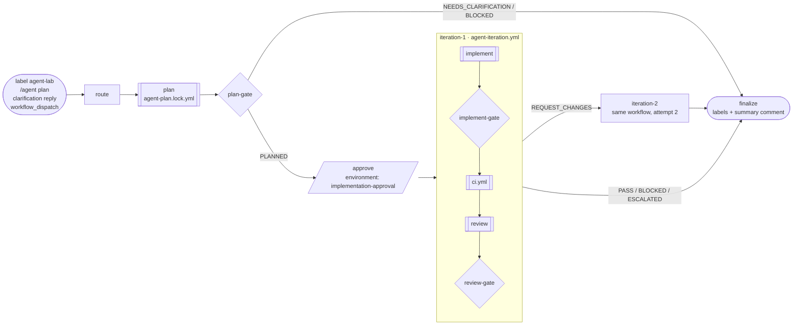

# Agent orchestration lab

One issue has one canonical draft PR throughout planning, implementation and
remediation. Orchestration is expressed **entirely as GitHub Actions workflows**:
one pipeline run chains the three gh-aw agents as reusable workflows. No Python
controller, no state branch, no `workflow_run` callbacks. No agent merges or deploys.

## Topology



| File | Role |
|---|---|
| `.github/workflows/agent-pipeline.yml` | Entry point and sequential orchestration (`needs`), human gate, bounded retry, escalation |
| `.github/workflows/agent-iteration.yml` | Reusable implement ► CI ► review cycle, called at most twice |
| `.github/workflows/agent-{plan,implement,review}.md` | gh-aw worker sources (`workflow_call`); compile to `.lock.yml` |
| `.github/workflows/shared/agent-prepare.md` | Shared trusted pre-agent step imported by all workers |
| `.github/workflows/ci.yml` | Also `workflow_call`, so the pipeline validates the exact PR head |
| `docs/agent-handoffs/*.schema.json` | Handoff contracts validated (ajv) at every gate |

### Orchestration concepts used (GH-600 mapping)

| Concept | Where |
|---|---|
| Sequential orchestration with `needs` | `route → plan → plan-gate → approve → iteration-1 → iteration-2 → finalize` |
| Reusable workflows (`workflow_call`), nested | pipeline → `agent-iteration.yml` → gh-aw locks / `ci.yml` |
| Artifact/handoff-based coordination | planner/implementation handoff files on the PR, review artifact, job outputs |
| Reasoning vs. writing boundary | agents run read-only; writes only via gh-aw safe outputs and trusted gate jobs |
| Human-in-the-loop gate | `environment: implementation-approval` with native human review bound to this run, head and spec/plan hashes |
| Isolation / concurrency | per-issue `concurrency` group; per-invocation gh-aw `job-discriminator` |
| Bounded retry + escalation threshold | exactly one remediation iteration; second `REQUEST_CHANGES` escalates |
| Failure handling | `finalize` runs `always()`, labels `agent:blocked`/`agent:escalated`, links the run |
| Observability | one run graph per revision, `agent:*` phase labels, step summary, issue comments |

## Repository controls

- `implementation-approval` environment **must** have a required human reviewer.
  An environment without protection rules runs `approve` immediately, which then
  fails closed because GitHub has no native human review for that run.
- Secrets used by the workers (`COPILOT_GITHUB_TOKEN`, gh-aw tokens) and
  `SONAR_TOKEN` are passed with `secrets: inherit`. No new secrets.
- Labels: `agent-lab` (entry), `agent-plan` (canonical PR marker). Phase labels
  `agent:planning`, `agent:needs-clarification`, `agent:awaiting-approval`,
  `agent:implementing`, `agent:reviewing`, `agent:ready-for-human-review`,
  `agent:blocked`, `agent:escalated` are created on first use.
- Keep CI and CODEOWNER protections. The `[Agent Lab] ` title prefix and the
  `agent-plan/issue-N` branch prefix are required.

## Start or resume

Apply `agent-lab` to an issue, comment `/agent plan` as a repository writer, or
run **Agent pipeline** manually with the issue number. `route` adopts the only
matching open agent PR, or creates `agent-plan/issue-N` with a data-only
`specs/issue-N/task.json` seed and a draft PR. More than one matching PR blocks:
close the extras, then start a new pipeline run. If the original branch already
exists without an open canonical PR, a fresh attempt uses
`agent-plan/issue-N-run-<run-id>-<attempt>` from current main and creates a new PR.
The old branch and closed PR are preserved; no force push or reopen is performed.
An existing open canonical PR is always reused. Closing a PR alone does not launch
a replacement: apply the entry label again or use Run workflow for the next attempt.

If the PR branch does not include current `main`, `route` updates it with
GitHub's update-branch (a merge commit, never a force-push) and plans on the new
head. This is safe because `route` always starts a new planning revision, so no
approval exists yet. A merge conflict blocks with the reason; resolve it, then
`/agent plan`. Non-writers' comments are ignored silently.

## Human input and approval

- **NEEDS_CLARIFICATION**: the run ends with `agent:needs-clarification`. A
  writer's ordinary reply on the issue starts a new run on the same PR.
- **PLANNED**: `plan-gate` posts the PR head and spec/plan hashes. Review those
  documents, then approve the pending `implementation-approval` deployment in
  that workflow run. **No `/agent approve` issue comment is required.**

  The trusted `approve` job reads GitHub's native review history for this exact
  run and requires an approved `implementation-approval` review by a human
  repository writer. It binds that evidence to the unchanged PR head,
  spec/plan hashes, main baseline and human issue decisions. An absent review,
  unprotected environment, rejected review or bot/non-writer does not authorize work.

  Every post-planning worker independently re-fetches that native review and
  rechecks the run/environment/actor, approved and current document bytes,
  ancestry, current issue snapshot and human answers before starting. A rerun
  of failed jobs may reuse the verified approval for the same unchanged plan
  in the same pipeline run; records from another run or a future attempt fail.
  `approved_at` records verification time because GitHub's review-history API
  does not return the review timestamp. Rejecting the deployment ends the run.

## Implementation, CI and review

`iteration-1` runs the Implementer on the approved head. `implement-gate`
validates `implementation-handoff.json` (schema, transition id, plan hash,
baseline, passing local checks) and that new commits were published. `ci.yml`
then runs **in the same run** on that exact remote head; any failing job stops
the iteration. The Reviewer writes `review-handoff.json` as an artifact;
`review-gate` validates layout, schema, identity, reviewed head and
decision/finding consistency. The Reviewer may COMMENT or REQUEST_CHANGES, never
APPROVE.

`REQUEST_CHANGES` triggers `iteration-2` with the findings as remediation
input. A second `REQUEST_CHANGES` escalates. `PASS` sets
`agent:ready-for-human-review`; humans own merge.

## Recovery

There is no durable state to repair: the workflow run *is* the state.

| Situation | Action |
|---|---|
| Transient failure (runner, API, model) | **Re-run failed jobs** on the run |
| Gate blocked (stale plan, moved head, revoked approval) | Fix the cause, then `/agent plan` |
| `main` moved while waiting for approval | `/agent plan` (route updates the branch and replans) |
| Want a fresh revision | `/agent plan` or manual dispatch (queued behind any active run for the issue) |
| Abandon a waiting run | Reject the deployment or cancel the run |

Approval commands and unrelated comments never queue behind, or replace, a run
waiting for approval (they get a unique concurrency group).

## Local checks

```bash
gh aw compile agent-plan agent-implement agent-review   # regenerate locks after editing .md sources
actionlint .github/workflows/agent-pipeline.yml .github/workflows/agent-iteration.yml .github/workflows/ci.yml
```

## Migration from the Python controller

Removed: `scripts/*.py` and tests, `agent-orchestrator.yml`,
`orchestration-state.schema.json`, `/agent adopt|recover|reset|reconcile`, the
`agent-orchestration-state` branch and the controller's diff-vs-execution_scope
check. The planner remains limited to `specs/**` and `.specify/feature.json` by
gh-aw `allowed-files`, and the implementer by its safe-output allowlist. The
`agent-orchestration-state` branch can be deleted manually after merge.

## Approval incident 41395908995

The Planner and plan-gate succeeded. LuisiitoDev approved the protected
implementation environment, but `approve` also required an exact issue command
and failed before that command was posted. Commands posted after a failed job
only produced skipped runs; they could not resume it. Native environment review
is now the sole human approval mechanism, independently bound to the exact plan.
This preserves workflow orchestration (`needs`/`workflow_call`) and human control.

For a source update, regenerate **all three** gh-aw locks because they import the
changed shared preparation. Compile on the fix branch before merging. Existing
runs keep their original workflow revision; rerunning an old run does not install
this patch. After merge, start a fresh pipeline from the Actions UI (issue number)
or reapply `agent-lab`. No issue command is needed. Hosted success remains an
integration check, not a result established by offline regression tests.
